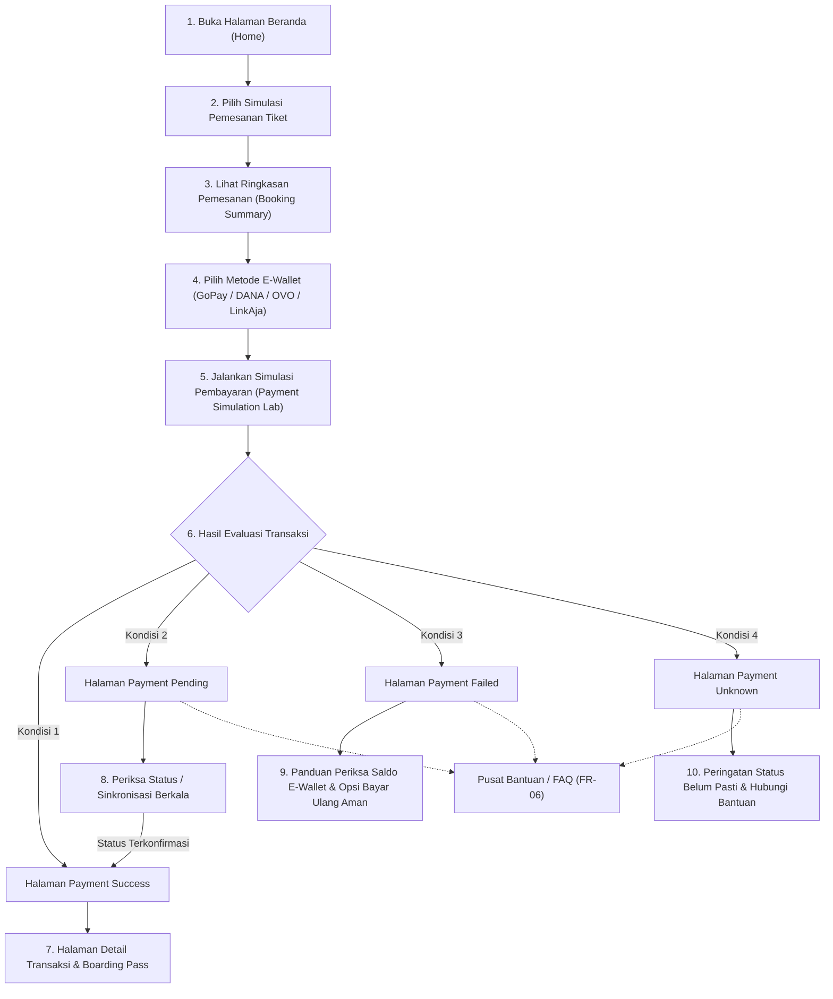

# Access by KAI — E-Wallet Payment Status & Recovery

> **PENTING / DISCLAIMER RESMI**:  
> Proyek ini merupakan **purwarupa demonstrasi UX (*Interactive Frontend UX Prototype*)** independen yang dirancang untuk menggambarkan solusi antarmuka pengguna pada aplikasi mobile **Access by KAI**. Website ini **bukan merupakan aplikasi resmi milik PT Kereta Api Indonesia (Persero)** dan bukan pengganti aplikasi mobile tersebut. Seluruh transaksi pembayaran bersifat **simulasi lokal (*dummy simulation*)**, tidak menggunakan *payment gateway* sungguhan, dan tidak memproses uang riil.

---

## 1. Project Overview

Proyek ini berjudul **Fitur Kejelasan Status Pembayaran E-Wallet pada Access by KAI** (*Feature: E-Wallet Payment Status & Recovery*). Dibangun sebagai implementasi komprehensif dari Product Requirements Document (PRD) untuk mengatasi salah satu friksi interaksi terbesar dalam proses pembelian tiket kereta api: **ketidakpastian status transaksi saat menggunakan dompet digital (*e-wallet*)**.

Website prototype ini mensimulasikan lingkungan aplikasi mobile Access by KAI secara *mobile-first*, lengkap dengan kontrol demonstrasi (*Demo Controls Lab*) untuk menguji 4 status transaksi utama (**Success**, **Pending**, **Failed**, dan **Unknown**), pemisahan tegas antara status pembayaran dan status pemesanan tiket, mekanisme proteksi pencegahan pembayaran ganda (*Anti-Double Payment Safeguard*), serta akses bantuan terpadu.

---

## 2. Product Information

| Informasi | Deskripsi |
|---|---|
| **Nama Produk** | Access by KAI |
| **Nama Fitur** | E-Wallet Payment Status & Recovery |
| **Jenis Dokumen** | Product Requirements Document (PRD) & UX Implementation |
| **Platform Produk** | Aplikasi Mobile Access by KAI (diwujudkan via Web Prototype) |
| **Fokus Permasalahan** | Ketidakjelasan status pembayaran tiket menggunakan e-wallet |
| **Target Pengguna** | Pengguna Access by KAI yang melakukan pembayaran menggunakan e-wallet |
| **Versi PRD** | V 1.0 (Final) |

---

## 3. Background

Pembayaran tiket kereta api melalui e-wallet (GoPay, DANA, OVO, LinkAja) merupakan salah satu proses penting dalam pemesanan tiket pada aplikasi Access by KAI karena kepraktisannya. Dalam proses tersebut, pengguna sangat membutuhkan kepastian bahwa pembayaran telah berhasil dan tiket telah diterbitkan.

Permasalahan UX yang menjadi fokus pengembangan adalah ketidakjelasan status pembayaran ketika transaksi mengalami kendala atau latensi jaringan:
1. Pengguna merasa khawatir apabila saldo e-wallet telah terpotong, tetapi status pembayaran pada aplikasi belum diperbarui atau tiket belum muncul.
2. Kurangnya pesan panduan yang transparan menyebabkan kebingungan apakah transaksi masih diproses, berhasil, atau gagal.
3. Ketidakpastian mendorong pengguna melakukan tindakan berbahaya: mencoba melakukan pembayaran ulang (*double payment*) saat transaksi pertama sebenarnya masih diproses oleh server atau e-wallet gateway, sehingga pengguna menanggung risiko pemotongan saldo ganda.

Oleh karena itu, diperlukan rancangan fitur yang dapat memberikan informasi status pembayaran secara jelas, menampilkan detail transaksi, memisahkan status pembayaran dengan status penerbitan tiket, serta menyediakan petunjuk penyelesaian masalah ketika pembayaran mengalami kendala.

---

## 4. Problem Statement

Pengguna Access by KAI mengalami ketidakpastian ketika melakukan pembayaran tiket menggunakan e-wallet, khususnya saat status transaksi belum jelas setelah pembayaran dilakukan. Pengguna membutuhkan informasi yang transparan mengenai status pembayaran dan pemesanan tiket agar dapat menentukan tindakan selanjutnya tanpa khawatir melakukan pembayaran berulang.

---

## 5. Product Goals

1. **Memberikan informasi status pembayaran e-wallet yang jelas dan mudah dipahami**: Menghilangkan ambiguitas melalui indikator visual, teks komunikatif, dan pembaruan berkala.
2. **Membantu pengguna mengetahui apakah pembayaran berhasil, sedang diproses, gagal, atau belum dipastikan**: Membedakan kondisi secara tegas agar pengguna tidak salah mengambil keputusan.
3. **Mengurangi risiko pengguna melakukan pembayaran ulang ketika transaksi sebelumnya belum mendapatkan kepastian**: Menyediakan *guard rails* sistemik yang memblokir pembayaran ganda saat transaksi masih *Pending* atau *Unknown*.
4. **Memudahkan pengguna memeriksa detail pembayaran dan status pemesanan tiket**: Memisahkan status pembayaran dari status tiket dalam satu tampilan terpadu yang konsisten.
5. **Memberikan arahan penyelesaian masalah ketika pembayaran mengalami kendala**: Menghadirkan panduan bertahap (*guided troubleshooting*) dan akses layanan bantuan yang mudah ditemukan.

---

## 6. Target Users

### Persona: Muhammad Senopati
- **Umur**: 21 tahun
- **Pekerjaan**: Mahasiswa
- **Karakteristik**: Menggunakan aplikasi Access by KAI untuk memesan tiket kereta api antarkota (perjalanan kampus - pulang kampung) dan secara konsisten memilih e-wallet sebagai metode pembayaran instan.
- **Tujuan (*Goals*)**: Menyelesaikan transaksi pemesanan tiket dengan cepat, tenang, dan segera memperoleh kepastian bahwa *Boarding Pass* digital telah aktif.
- **Permasalahan (*Pain Points*)**: Merasa cemas saat saldo e-wallet berkurang namun aplikasi tiket masih memuat atau tidak menampilkan tiket; takut kehabisan kursi sehingga tergoda memesan ulang; tidak tahu apakah saldo yang terpotong akan kembali atau hangus saat pembayaran error.
- **Kebutuhan (*Needs*)**: Konfirmasi status transaksi yang transparan, penjelasan bahasa manusia tanpa kode error teknis, pencegahan bayar ganda, dan saluran bantuan responsif.

---

## 7. Product Scope

### 7.1 In Scope
Fitur yang direpresentasikan dalam prototype:
1. **Payment Status Display**: Menampilkan 4 status pembayaran secara eksplisit (Menunggu Pembayaran/Pending, Berhasil/Success, Gagal/Failed, dan Belum Dapat Dipastikan/Unknown).
2. **Payment Confirmation**: Menampilkan informasi konfirmasi setelah sistem menerima hasil pembayaran dari penyedia e-wallet.
3. **Transaction Detail**: Menampilkan detail transaksi mencakup metode pembayaran, nominal, waktu transaksi, status pembayaran, status tiket, dan riwayat status (*timeline*).
4. **Payment Error Notification**: Menampilkan pesan kesalahan dalam bahasa Indonesia yang ramah, santun, dan menyertakan arahan tindakan konkret.
5. **Payment Status Verification**: Tombol sinkronisasi manual untuk memeriksa status transaksi ke gateway sebelum mengizinkan pembayaran ulang.
6. **Customer Support Access**: Akses mudah menuju Pusat Bantuan, FAQ kontekstual, formulir laporan kendala, dan saluran resmi CS KAI.

### 7.2 Out of Scope
1. Menambahkan penyedia e-wallet baru sebagai sistem pembayaran sungguhan di luar mock data.
2. Mengembangkan sistem e-wallet atau dompet digital milik internal Access by KAI.
3. Mengubah kebijakan pengembalian dana (*refund policy*) dari penyedia pembayaran.
4. Mengembangkan keseluruhan sistem pemesanan tiket kereta api (seperti pemilihan gerbong/kursi dinamis, payment gateway riil, dan integrasi backend KAI).
5. Mengembangkan sistem penyelesaian sengketa transaksi secara mandiri di luar simulasi formulir laporan kendala.

---

## 8. Functional Requirements (FR)

| ID | Functional Requirement | Deskripsi Kebutuhan PRD | Implementasi Prototype |
|---|---|---|---|
| **FR-01** | Menampilkan Status Pembayaran | Sistem menampilkan status pembayaran berdasarkan informasi transaksi yang diterima dari penyedia pembayaran. | Menampilkan 4 status (*Success, Pending, Failed, Unknown*) dengan visual badge, ikon, warna, dan deskripsi transparan. |
| **FR-02** | Memberikan Konfirmasi Pembayaran | Sistem menampilkan konfirmasi ketika pembayaran telah dinyatakan berhasil. | Menampilkan halaman Payment Success dengan ucapan terima kasih, nomor referensi, rincian perjalanan, dan status tiket terpisah. |
| **FR-03** | Menampilkan Notifikasi Kesalahan | Sistem memberikan informasi ketika pembayaran gagal atau mengalami kendala. | Halaman Payment Failed & Unknown menyajikan alasan ramah pengguna, peringatan saldo, dan arahan konkret tanpa kode teknis mentah. |
| **FR-04** | Memverifikasi Status Transaksi | Sistem memeriksa status transaksi sebelumnya sebelum mengizinkan pengguna melakukan pembayaran ulang. | Tombol *Periksa Status* memicu verifikasi simulasi; tombol bayar ulang dikunci total selama status *Pending* atau *Unknown*. |
| **FR-05** | Menampilkan Detail Transaksi | Sistem menampilkan metode pembayaran, nominal, waktu transaksi, dan status pemesanan tiket. | Halaman Transaction Detail menyajikan data lengkap secara konsisten dari satu sumber state terpadu (`TransactionContext`). |
| **FR-06** | Menyediakan Akses Bantuan | Sistem menyediakan akses layanan bantuan pada halaman detail transaksi atau halaman kesalahan pembayaran. | Tombol bantuan di setiap halaman kendala, mengarah ke FAQ interaktif dan formulir Lapor Kendala Pembayaran E-Wallet. |

---

## 9. UX Requirements (UX)

| ID | UX Requirement | Deskripsi |
|---|---|---|
| **UX-01** | **Bahasa yang Mudah Dipahami** | Pesan status dan kesalahan menggunakan bahasa sederhana, empatik, serta menghindari kode teknis tanpa penjelasan. |
| **UX-02** | **Indikator Status yang Jelas** | Setiap status transaksi memiliki teks nama status dan indikator visual (warna + ikon) yang mudah dibedakan dalam < 2 detik. |
| **UX-03** | **Informasi Transparan** | Pengguna dapat mengetahui kondisi pembayaran, status pemesanan tiket, rincian biaya, dan tindakan selanjutnya tanpa menebak-nebak. |
| **UX-04** | **Pencegahan Pembayaran Ganda** | Sistem memberikan peringatan visual dan memblokir opsi pemesanan/pembayaran ulang apabila transaksi sebelumnya masih berstatus *Pending* atau *Unknown*. |
| **UX-05** | **Kemudahan Akses Informasi** | Detail pembayaran, status pemesanan, dan pusat bantuan dapat diakses secara instan dari navigasi bawah maupun tombol kontekstual. |

---

## 10. User Stories

1. **US-01**: *Sebagai pengguna Access by KAI*, saya ingin melihat status pembayaran e-wallet secara jelas, *sehingga* saya dapat mengetahui apakah pembayaran berhasil, sedang diproses, atau gagal.
2. **US-02**: *Sebagai pengguna Access by KAI*, saya ingin mendapatkan notifikasi yang menjelaskan penyebab kegagalan pembayaran dengan bahasa sederhana, *sehingga* saya dapat memahami kendala yang terjadi dan mengetahui tindakan selanjutnya.
3. **US-03**: *Sebagai pengguna Access by KAI*, saya ingin mendapatkan konfirmasi status transaksi sebelum melakukan pembayaran ulang, *sehingga* saya dapat menghindari pemotongan saldo e-wallet secara berulang.
4. **US-04**: *Sebagai pengguna Access by KAI*, saya ingin melihat detail pembayaran dan status pemesanan tiket dalam satu halaman, *sehingga* saya dapat memastikan transaksi dan penerbitan tiket tanpa harus memeriksa banyak halaman.
5. **US-05**: *Sebagai pengguna Access by KAI*, saya ingin mendapatkan akses bantuan ketika pembayaran e-wallet mengalami kendala, *sehingga* saya dapat memperoleh solusi ketika status pembayaran belum jelas.

---

## 11. Acceptance Criteria (AC)

| ID | Fitur | Kriteria Penerimaan |
|---|---|---|
| **AC-01** | Status Pembayaran | Pengguna dapat melihat status pembayaran yang sesuai dengan hasil konfirmasi transaksi dari penyedia pembayaran. |
| **AC-02** | Konfirmasi Pembayaran | Ketika pembayaran berhasil dikonfirmasi, sistem menampilkan status berhasil dan informasi pemesanan tiket. |
| **AC-03** | Notifikasi Kesalahan | Ketika pembayaran gagal, sistem menampilkan pesan yang menjelaskan kondisi dan tindakan selanjutnya. |
| **AC-04** | Verifikasi Transaksi | Ketika status transaksi sebelumnya masih diproses, sistem tidak langsung mengarahkan pengguna untuk membayar ulang. |
| **AC-05** | Detail Transaksi | Pengguna dapat melihat metode pembayaran, nominal, waktu transaksi, dan status pemesanan dalam halaman detail transaksi. |
| **AC-06** | Bantuan Pengguna | Pengguna dapat mengakses layanan bantuan ketika mengalami kendala pembayaran. |

---

## 12. User Flow

Alur interaksi prototipe:


---

## 13. Transaction Status Definition

Empat status transaksi diimplementasikan sebagai kondisi yang terpisah dan unik:

### 13.1 Success (Pembayaran Berhasil)
- **Kondisi**: Transaksi telah diotorisasi dan disahkan oleh server e-wallet.
- **Tampilan**: Indikator hijau emerald (`#10B981`), ikon centang, pesan kepastian, rincian transaksi, dan status tiket.
- **Perilaku**: Pembayaran berhasil tidak otomatis berarti tiket langsung terbit jika proses penerbitan tiket mengalami antrean (*Waiting for Ticket Issuance*). Tidak ada opsi bayar ulang.

### 13.2 Pending (Sedang Diproses)
- **Kondisi**: Otorisasi e-wallet telah dikirim, namun gateway sedang mengalami latensi atau menunggu antrean rekonsiliasi.
- **Tampilan**: Indikator oranye/amber (`#F58220`), animasi pemrosesan, timer sinkronisasi, pesan penenang.
- **Perilaku**: **Dilarang keras menampilkan tombol bayar ulang**. Menyediakan tombol *Periksa Status* untuk memicu sinkronisasi manual.

### 13.3 Failed (Pembayaran Gagal)
- **Kondisi**: Otorisasi pembayaran ditolak oleh e-wallet (saldo tidak cukup, PIN salah, sesi habis, atau penolakan gateway).
- **Tampilan**: Indikator merah crimson (`#DC2626`), ikon peringatan, pesan kegagalan ramah, asisten pemeriksa saldo e-wallet.
- **Perilaku**: Tidak langsung mengasumsikan saldo terpotong atau tidak terpotong. Pembayaran ulang hanya diizinkan apabila pengguna telah memverifikasi saldo aman atau simulasi menyatakan aman.

### 13.4 Unknown (Status Belum Dapat Dipastikan)
- **Kondisi**: Terjadi kegagalan komunikasi jaringan antara Access by KAI dan penyedia e-wallet setelah permintaan pembayaran dikirim (koneksi terputus di tengah jalan).
- **Tampilan**: Indikator ungu/indigo (`#6366F1`) dengan ikon tanda tanya melingkar, pesan bahwa sistem sedang mencari konfirmasi pihak ketiga.
- **Perilaku**: **Bukan status Failed!** Jangan menawarkan tombol pembayaran ulang sebagai aksi utama. Pengguna diwajibkan menunggu, memeriksa status berkala, atau menghubungi CS sebelum mengambil tindakan keuangan baru.

---

## 14. Non-Functional Requirements (NFR)

| ID | Kategori | Kebutuhan PRD | Realisasi Teknis Prototype |
|---|---|---|---|
| **NFR-01** | **Reliability** | Status pembayaran harus mencerminkan hasil verifikasi transaksi dari penyedia pembayaran. | Menggunakan Single Source of Truth (`TransactionContext`) dengan riwayat perubahan status auditabel. |
| **NFR-02** | **Security** | Informasi transaksi pengguna harus dilindungi dan tidak menampilkan data sensitif. | Tidak meminta PIN, OTP, nomor kartu, atau saldo riil pengguna. Data berupa mock data yang aman. |
| **NFR-03** | **Performance** | Informasi status transaksi ditampilkan tanpa waktu tunggu yang tidak perlu. | Respons transisi halaman instan via Vite + React SPA, dengan indikator loading simulasi realistis (1.5 detik). |
| **NFR-04** | **Usability** | Tampilan mudah dipahami oleh pengguna lintas generasi dan tingkat literasi digital. | Kontras warna standar WCAG AA, tipografi jelas (`Inter`), ikonografi Lucide berlabel teks. |
| **NFR-05** | **Consistency** | Informasi status pembayaran dan pemesanan tiket konsisten di seluruh halaman. | Halaman Beranda, Hasil Pembayaran, Detail Transaksi, dan Tiket membaca state yang sama. |

---

## 15. Success Metrics

1. **Reduksi Kecemasan Pengguna**: Peningkatan skor kepastian pengguna melalui pesan penjelas yang ramah dan menenangkan.
2. **Eliminasi Pembayaran Ganda**: Tercapainya 0% insiden *accidental double payment* melalui penguncian sistematis saat status *Pending* atau *Unknown*.
3. **Peningkatan Pemahaman Status**: Pengguna dapat membedakan status *Pending*, *Failed*, dan *Unknown* secara tepat dalam pengujian kegunaan (*Usability Testing*).
4. **Kecepatan Akses Bantuan**: Waktu yang dibutuhkan pengguna menemukan kanal bantuan dan panduan kendala berkurang hingga < 5 detik.
5. **Kepuasan Informasi Transaksi**: Peningkatan persepsi transparansi informasi biaya dan status penerbitan tiket.

---

## 16. Dependencies and Risks

### Dependencies:
1. Ketersediaan API callback/webhook dari penyedia e-wallet (disimulasikan oleh Demo Controls).
2. Mekanisme rekonsiliasi berkala (*reconciliation service*) antara perbankan/e-wallet dan core ticketing KAI.
3. Ketersediaan kanal bantuan pelanggan (Call Center 121, WhatsApp Resmi, CS Stasiun).

### Risks & Mitigasi UX:
- **Risiko**: Keterlambatan respon gateway e-wallet yang melebihi 15 menit.  
  *Mitigasi UX*: Status dialihkan ke *Unknown* dengan pesan jaminan saldo dan tiket investigasi otomatis.
- **Risiko**: Saldo pengguna terpotong pada e-wallet namun gateway melaporkan *Failed*.  
  *Mitigasi UX*: Formulir *Lapor Kendala Transaksi* otomatis menyertakan Transaction ID dummy dan panduan rekonsiliasi saldo 1x24 jam.

---

## 17. Technical Implementation

- **Framework**: React 18 (Vite SPA)
- **Styling**: Tailwind CSS dengan palet resmi terinspirasi dari identitas Access by KAI (Deep Blue `#1D3F7A`, Orange Accent `#ED6B23`)
- **Routing**: Client-Side Routing multi-page yang mulus dengan browser history support
- **Icons**: Lucide React Icons
- **State Management**: React Context API (`TransactionContext`) dengan persistensi `localStorage`
- **Simulation**: Demo Control Bar interaktif untuk beralih status seketika tanpa mengubah kode

---

## 18. Website Prototype

Prototype website menyajikan dua mode tampilan:
1. **Mobile Frame View**: Simulasi tampilan smartphone proporsional (layar 420px berbingkai rapi) yang sangat representatif untuk demonstrasi mobile UX.
2. **Full Responsive View**: Tampilan responsif yang beradaptasi secara elegan pada tablet dan layar desktop.

---

## 19. Installation Guide

Pastikan Node.js (versi 18 ke atas) telah terinstal pada perangkat Anda.

```bash
# 1. Buka terminal pada folder proyek
cd "d:\Semester 7\Rekayasa Interaksi\prd_skill"

# 2. Instal seluruh dependensi
npm install
```

---

## 20. How to Run

```bash
# Menjalankan server pengembangan lokal (Vite)
npm run dev

# Membangun versi produksi (Build)
npm run build

# Menjalankan preview dari build produksi
npm run preview
```

Setelah server aktif, buka browser pada alamat:
`http://localhost:3000` (atau port yang ditampilkan pada terminal).

---

## 21. Testing Guide

Tersedia **Demo Controls Panel** mengambang (*floating lab bar*) di bagian bawah layar untuk menguji seluruh skenario pengujian:

1. **Uji Skenario Success**: Klik *"Simulate Success"*, verifikasi pesan berhasil dan status tiket.
2. **Uji Skenario Pending**: Klik *"Simulate Pending"*, verifikasi bahwa tombol bayar ulang diblokir dan muncul tombol *Periksa Status*.
3. **Uji Skenario Failed**: Klik *"Simulate Failed"*, ikuti asisten periksa saldo e-wallet.
4. **Uji Skenario Unknown**: Klik *"Simulate Unknown"*, pastikan status dibedakan dari Failed dan bayar ulang dicegah.
5. **Uji Payment Success + Ticket Pending**: Simulasikan pembayaran lunas namun tiket masih dalam antrean penerbitan (*Waiting for Ticket Issuance*).
6. **Uji Reset Simulation**: Klik *"Reset Simulation"* untuk mengembalikan state ke kondisi awal.

Dokumentasi hasil pengujian lengkap dapat dilihat pada [docs/Testing-Documentation.md](file:///d:/Semester%207/Rekayasa%20Interaksi/prd_skill/docs/Testing-Documentation.md).

---

## 22. Project Structure

```
Access-by-KAI-UX/
│
├── README.md                      # Dokumentasi Utama PRD & Panduan Proyek
├── CHANGELOG.md                   # Catatan Riwayat Perubahan Proyek
├── agent.md                       # Instruksi Operasional AI Agent
├── package.json                   # Konfigurasi Dependensi & Script
├── package-lock.json              # Lockfile Dependensi
├── vite.config.js                 # Konfigurasi Vite
├── tailwind.config.js             # Desain Sistem & Tema Tailwind
├── postcss.config.js              # Konfigurasi PostCSS
├── index.html                     # Entry point HTML
├── .gitignore                     # Aturan Git Ignore
│
├── .agent/
│   └── skills/
│       └── access-by-kai-ux/
│           └── SKILL.md           # Panduan Kerja UX untuk AI Agent
│
├── docs/
│   ├── Project-Documentation.md    # Dokumentasi Arsitektur & Rekayasa Proyek
│   ├── User-Flow.md               # Visualisasi & Spesifikasi Alur Interaksi
│   ├── Requirement-Traceability.md # Matriks Penelusuran Kebutuhan (RTM)
│   ├── Testing-Documentation.md   # Hasil Uji Fungsional & Usability Testing
│   └── Design-Guidelines.md       # Panduan Desain Visual, Warna & Aksesibilitas
│
├── public/
│   └── assets/                    # Aset statis publik (logo, ikon SVG)
│
└── src/
    ├── assets/                    # Aset internal
    ├── components/                # Komponen UI Reusable (Header, Nav, Modal, DemoBar)
    ├── layouts/                   # Layout Utama & Frame Simulator HP
    ├── pages/                     # Halaman Aplikasi (Home, Booking, Status, Help, dll)
    ├── data/                      # Mock Data Tiket, Kereta, Stasiun, FAQ
    ├── hooks/                     # Custom Hooks React
    ├── context/                   # TransactionContext & State Provider
    ├── utils/                     # Format tanggal, mata uang, helper status
    ├── styles/                    # Gaya CSS Tambahan
    ├── App.jsx                    # Komponen Utama Router & Shell
    └── main.jsx                   # Entry point React DOM
```

---

## 23. Limitations

1. **Simulasi Lokal**: Transaksi tidak terhubung ke bank atau e-wallet riil.
2. **Tidak Ada Basis Data Backend**: State disimpan pada memori browser dan `localStorage`.
3. **Data Jadwal Statis**: Pencarian jadwal menggunakan data tiruan (*mock schedule*) untuk rute populer Jakarta (Gambir) - Yogyakarta (YK).
4. **Bukan Pengganti Aplikasi Resmi**: Dibuat semata-mata untuk tujuan riset UX, tugas mata kuliah Rekayasa Interaksi, dan evaluasi antarmuka.

---
*Dokumen ini disusun untuk memastikan kepatuhan penuh terhadap spesifikasi Product Requirements Document (PRD).*
