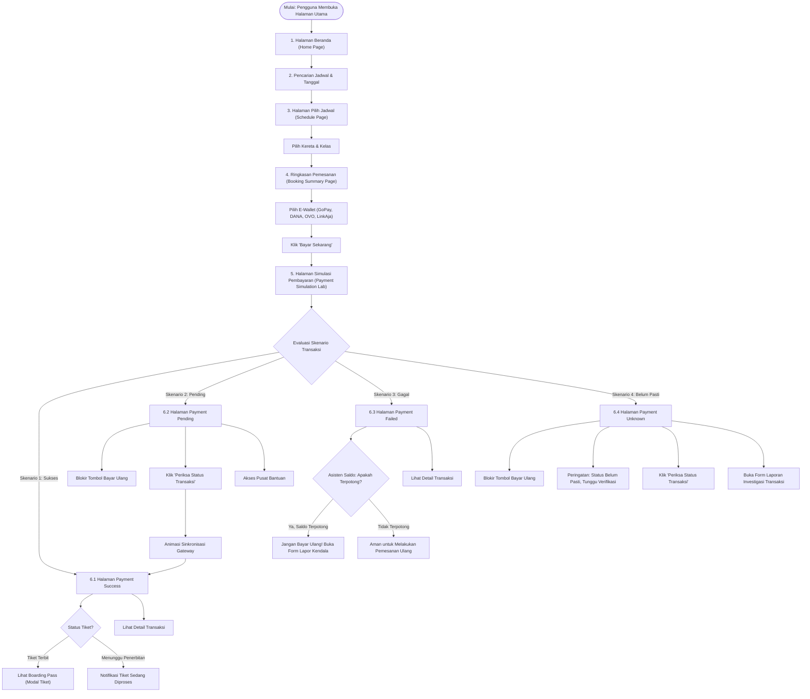

# User Flow: Access by KAI E-Wallet Payment & Recovery

## 1. Ikhtisar Alur Pengguna (User Flow Overview)
Alur interaksi pada purwarupa dirancang untuk memandu pengguna dari pencarian jadwal, ringkasan pemesanan, simulasi gateway pembayaran, hingga menangani 4 kemungkinan hasil transaksi secara transparan dan aman.

---

## 2. Diagram Alur Utama (End-to-End Flowchart)

---

## 3. Rincian Langkah Demi Langkah

### Langkah 1: Beranda & Pemilihan Rute
- Pengguna melihat sapaan persona (*Halo, Muhammad Senopati*).
- Jika ada transaksi sebelumnya yang masih berstatus `Pending` atau `Unknown`, banner peringatan interaktif langsung muncul di bagian atas untuk mencegah pengguna memesan tiket baru tanpa kepastian.
- Pengguna memilih stasiun asal (Gambir), stasiun tujuan (Bandung), tanggal keberangkatan, dan menekan *"Cari Tiket Kereta"*.

### Langkah 2: Pemilihan Jadwal Kereta
- Pengguna memfilter kelas (Eksekutif/Ekonomi) dan mengurutkan harga termurah.
- Pengguna memilih jadwal kereta api (contoh: *Argo Parahyangan*).

### Langkah 3: Ringkasan Pemesanan & Metode Pembayaran
- Pengguna memeriksa rincian perjalanan, nama penumpang, gerbong/kursi dummy.
- Pengguna memilih salah satu dompet digital: **GoPay**, **DANA**, **OVO**, atau **LinkAja**.
- Total nominal ditampilkan dengan transparan (misal Rp 150.000).
- Pengguna menekan tombol *"Bayar Sekarang"*.

### Langkah 4: Simulasi Gateway Pembayaran
- Halaman simulasi menampilkan batas waktu pembayaran (*countdown timer* 15 menit), detail transaksi, dan tombol pengendali status untuk demonstrasi UX.

### Langkah 5: Penanganan 4 Kondisi Status
1. **Sukses (`SUCCESS`)**:
   - Menampilkan ikon centang hijau, kode booking unik (misal `KAI-88A9F1`), nomor transaksi, dan status tiket.
   - Jika tiket terbit: Pengguna dapat langsung membuka modal *Boarding Pass* digital dengan QR code dummy.
   - Jika tiket menunggu penerbitan: Pengguna diberi informasi penenang bahwa pembayaran sudah beres dan tiket sedang diantrikan.
2. **Sedang Diproses (`PENDING`)**:
   - Menampilkan indikator loading oranye.
   - Menampilkan peringatan tegas: *"Jangan melakukan pembayaran ulang sebelum status transaksi sebelumnya dipastikan."*
   - Tombol bayar ulang dinonaktifkan secara total.
   - Pengguna dapat mengklik tombol *"Periksa Status"* untuk memicu verifikasi ke gateway.
3. **Gagal (`FAILED`)**:
   - Menampilkan ikon merah dan penjelasan kegagalan ramah pengguna tanpa kode teknis mentah.
   - Menyediakan asisten interaktif *"Apakah saldo e-wallet Anda terpotong?"*:
     - Jika pengguna memilih *"Ya"*: Sistem memperingatkan untuk **tidak** membayar ulang dan mengarahkan ke form laporan pengembalian dana 1x24 jam.
     - Jika pengguna memilih *"Tidak"*: Sistem membuka opsi mencoba pembayaran kembali secara aman.
4. **Belum Dapat Dipastikan (`UNKNOWN`)**:
   - Menampilkan indikator ungu dengan pesan bahwa terjadi latensi jaringan antara KAI dan penyedia e-wallet.
   - Memperlakukan status ini secara hati-hati: melarang bayar ulang dan meminta pengguna menunggu atau menghubungi CS.

### Langkah 6: Detail Transaksi & Pusat Bantuan
- Pengguna dapat membuka halaman Detail Transaksi kapan saja melalui navigasi bawah.
- Halaman menyajikan data sinkron: nomor transaksi, kode booking, metode pembayaran, nominal, tanggal, waktu, status pembayaran, status tiket, dan riwayat audit perubahan status (*status history timeline*).
- Halaman Pusat Bantuan menyajikan accordion FAQ 5 pertanyaan kunci dan modal formulir laporan kendala e-wallet.
